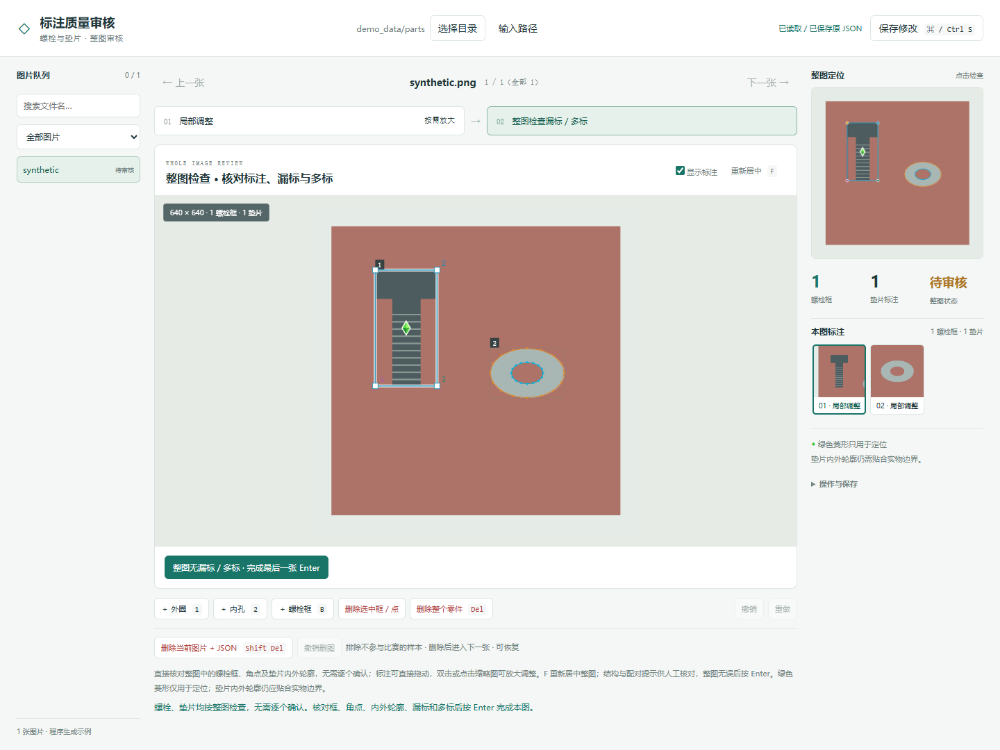
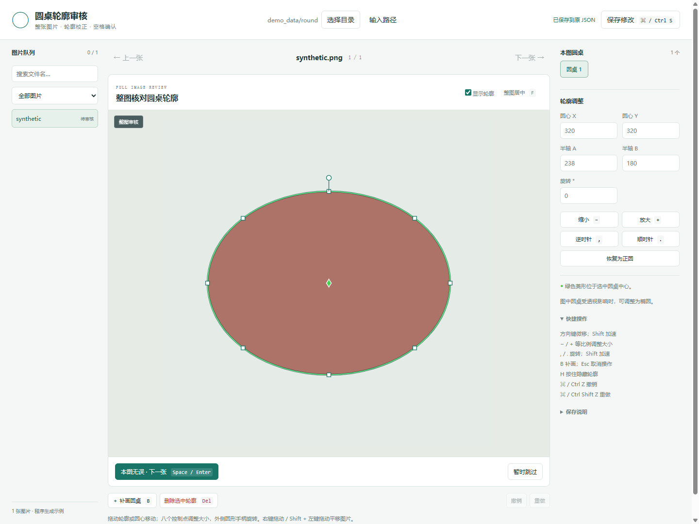
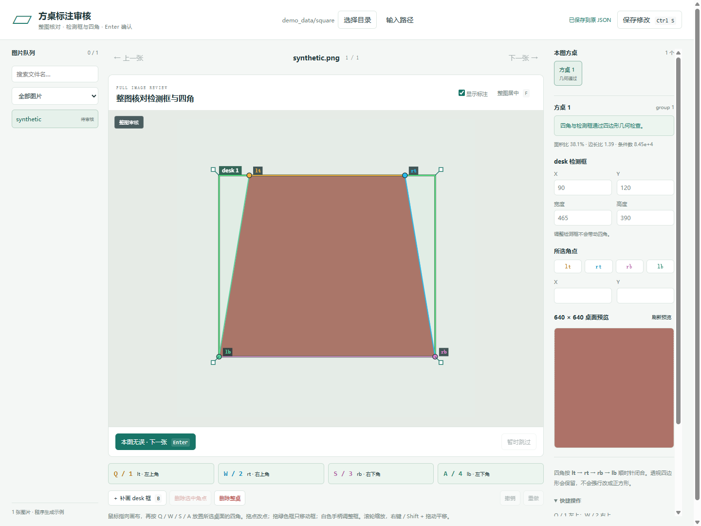

# Industrial Annotation Reviewer · 工业测量标注审核工具

在本地浏览器中检查和修改 **圆桌、方桌、螺栓、垫片** 的 LabelMe 标注。可用于工业测量比赛的数据标注与质量审核，也适用于一般的桌面轮廓、零件关键点和内外轮廓数据集。

项目提供人工审核工具与设计说明，不代表比赛官方工具，不包含比赛数据、模型权重或官方评测实现。



<details>
<summary>圆桌与方桌界面（合成示例）</summary>




</details>

## 支持什么

| 对象 | 标注格式 | 编辑方式 |
| --- | --- | --- |
| 圆桌 | `circle` 多边形或圆，也识别 `round`、`round_table`、`table_circle`、`圆桌`、`圆桌轮廓` | 平移、缩放、旋转椭圆，补画/删除轮廓 |
| 方桌 | `desk` 框 + `lt/rt/rb/lb` 四角，同一桌使用相同 `group_id` | 框与角点独立编辑，几何校验，640×640 透视预览 |
| 螺栓 | `screw` 框 + `top_left/top_right/bot_left/bot_right` 四角 | 整图检查、局部放大、补点/删点、补框/删零件 |
| 垫片 | `wai/nei` 内外轮廓，或 `shim` 框 + 六个参考点 | 内外椭圆分别调整；六点格式直接编辑原参考点 |

- 螺栓、垫片按 **整张图片** 确认，无需逐个确认零件。
- 同组角点优先按 `group_id` 对应；归属不明的螺栓角点保留为未分组点，避免借用相邻零件的点。
- 自动保存、撤销/重做、审核进度、未保存草稿与外部文件冲突检测。
- 零件工具支持成对移除图片和 JSON，以及撤销删图。
- 前端无需 Node.js、构建步骤或 CDN；服务只绑定 `127.0.0.1`。

## 本地部署

需要 Python **3.10 或以上**，以及近期版本的 Chrome、Edge 或 Firefox。三个网页工具均可通过终端启动。图形目录选择器需要 Tkinter；没有 Tkinter 时可在网页中输入路径。

```bash
git clone https://github.com/xunju/industrial-annotation-reviewer.git
cd industrial-annotation-reviewer
python -m venv .venv
```

激活环境：

```powershell
# Windows PowerShell
.venv\Scripts\Activate.ps1
```

```bash
# macOS / Linux（系统命令可能为 python3）
source .venv/bin/activate
```

安装方桌预览依赖并启动全部工具：

```bash
python -m pip install -r requirements.txt
python run.py
```

| 页面 | 地址 |
| --- | --- |
| 圆桌 | http://127.0.0.1:8874/ |
| 方桌 | http://127.0.0.1:8875/ |
| 螺栓与垫片 | http://127.0.0.1:8876/ |

保持终端打开；按 **Ctrl+C** 停止本次启动的服务。关闭浏览器标签页不会停止服务。也可在环境中运行 `start.bat`（Windows）或 `sh start.sh`（macOS/Linux）。

仅使用圆桌或零件工具时，无需安装第三方 Python 包：

```bash
python run.py --tool round
python run.py --tool parts
python run.py --tool square --port 8895
python run.py --tool parts --dataset ./datasets/my-labelme-data --no-browser
```

端口被占用时启动器会报错，不会连接到另一个已有程序。远程无桌面环境可使用 `--no-browser` 并自行安排本机端口转发；本项目不提供公网部署和多用户访问控制。

## 先试合成示例

```bash
python run.py --demo
```

这会用标准库生成三组合成图片和 JSON，分别在三个页面中打开。示例完全由程序绘制，不包含真实照片。重复启动会保留已有示例修改；要重置，可移走 `demo_data` 后重新运行。

## 打开自己的数据

```text
my-labelme-data/
  sample.png
  sample.json
```

JSON 需要 `imagePath`、`imageWidth`、`imageHeight`、`shapes`；图片支持 PNG、JPG/JPEG、BMP、WebP。选择目录会递归扫描子目录。请先解压 ZIP，配对的空 `shapes` JSON 可以补标；只有图片时不会自动创建 JSON。大于 10 MB 的单个 JSON 会跳过，建议使用外部图片并将 `imageData` 设为 `null`。

这不是 YOLO/COCO 通用导入器，也不自动把三点垫片变成可靠椭圆；已有六点垫片会保留参考点。坐标必须属于当前图片，不能直接给裁剪图使用原图坐标。

## 常用操作

| 操作 | 快捷键 |
| --- | --- |
| 重新居中 | **F**；零件局部视图居中当前零件 |
| 缩放 / 平移 | 滚轮 / 右键拖动，或 Shift + 拖动 |
| 临时隐藏标注 | 按住 H |
| 保存 / 撤销 / 重做 | Ctrl（macOS 为 Command）+ S / Z / Shift+Z |
| 方桌或螺栓四点 | 鼠标指向目标，Q/W/S/A 或 1/2/3/4 |
| 补桌面或螺栓框 | B 后拖动 |
| 零件局部返回整图 | 空格，不逐个确认 |
| 完成整图审核 | Enter；圆桌也支持空格 |
| 零件工具移除图片 + JSON | Shift+Delete，支持“撤销删图” |

垫片在整图用“＋外圈 / 内孔”补画，进入局部后调整轮廓。螺栓的绿色菱形只是框中心的定位提示，不是额外的中心标签。检测框和四个角点分别调整。

## 保存与数据安全

**编辑会直接写回你选择的数据集 JSON，请使用工作副本。** 未编辑坐标和无关类别尽量原样保留；保存会更新审核字段及 JSON 排版。审核进度随 JSON 保存，继承他人已完成记录不代表你自己已经审核过。

三个工具检查文件版本，外部修改导致冲突时拒绝覆盖。浏览器本地存储保留草稿和位置；换浏览器、路径或端口后这些浏览器记录不会自动迁移。零件工具的删除将配对文件归档到数据集 `.review_deleted`，并非永久销毁；请连同隐藏目录保留，以便恢复。

浏览器通过回环地址访问本机 Python 服务；工具没有云端上传、遥测、账号登录或模型 API。日志、草稿和 JSON 可能包含你自己的路径与内容，报告问题前请脱敏。

## 设计与扩展

参见 [设计方法](docs/DESIGN.md)、[标注格式](docs/ANNOTATION_FORMAT.md)、[隐私与发布边界](docs/PRIVACY.md)。

方桌校验由本项目独立实现，基于 NumPy 和 OpenCV 的标准几何运算。当前门限是演示工具的默认规则，**不是任何比赛或模型的官方标准**；不同分辨率和拍摄范围可修改 `square_table_review/quad_geometry.py`。圆桌以椭圆编辑现有轮廓，不支持任意多边形顶点逐点编辑。

```bash
python -m unittest discover -s tests -v
node --test tests/models.test.js   # 可选：前端几何回归，运行时不需要 Node.js
```

MIT 许可证。NumPy 和 OpenCV 按其各自许可证分发，依赖安装在本地，不随本仓库打包。欢迎提交不含真实数据和个人信息的最小复现。

## 数据集批处理工具

自动预标注、圆桌轮廓优化、零件标注修补、数据集整理和离线检查脚本见 [tools/README.md](tools/README.md)。工具依赖单独安装，模型需自行提供；实验性修补结果需要人工审核。
